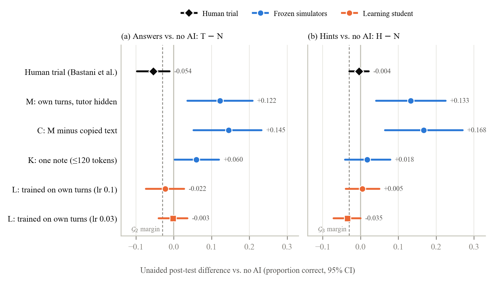

# The Crutch Test

Do LLM-simulated students pay the "crutch cost" of copied answers? In a randomized trial with about a thousand high-school students, unrestricted GPT-4 raised practice scores but lowered the unaided exam by 0.054 (17%), while a hint-only tutor did not ([Bastani et al., PNAS 2025](https://doi.org/10.1073/pnas.2422633122)). If simulated students do not pay this cost, tutor rewards built on them favor tutors that simply hand over answers.

The Crutch Test runs a student simulator through the trial's three arms (no AI, hints, answers), tests it unaided on an unseen variant of the tutored problem, and checks the paired differences against pass gates taken from the trial's effects. The write-up is in [`crutch-test/report/`](crutch-test/report/).



## Pilot results

50 Big-Math problems, one dialog per arm, a Llama-3.1-8B-Instruct student and Claude Haiku 5.5 tutors. Each cell is the difference in unaided score on the unseen variant against no AI, paired by problem, with a 95% cluster-bootstrap interval.

| Student simulator | T - N (answers) | H - N (hints) |
|---|---|---|
| Human trial (Bastani et al.) | -0.054 [-0.097, -0.011] | -0.004 [-0.029, +0.021] |
| M: own turns, tutor hidden | +0.122 [+0.036, +0.209] | +0.133 [+0.041, +0.225] |
| C: M minus copied text | +0.145 [+0.052, +0.233] | +0.168 [+0.065, +0.270] |
| K: one note of at most 120 tokens | +0.060 [+0.003, +0.120] | +0.018 [-0.041, +0.079] |
| L: LoRA trained on its own turns, lr 0.1 | -0.022 [-0.074, +0.028] | +0.005 [-0.039, +0.050] |
| L: LoRA trained on its own turns, lr 0.03 | -0.003 [-0.040, +0.036] | -0.035 [-0.071, +0.000] |

The frozen simulators (M, C, K) gain from being told the answer, where students lost. The learning student removes that gain at both learning rates but does not reproduce the human cost, and no setting passes every gate at pilot scale. With the dialog in view, answers raise the same-problem score by +0.574, so the tutors do help in the moment.

## Reproduce

Linux, macOS or WSL; no GPU and no API key. Setup builds a venv and downloads EduardoRL, the dataset and the trial's log (about 2 minutes). Where `python3 -m venv` is missing, the setup step in [`crutch-test/README.md`](crutch-test/README.md) shows how to use uv instead.

```bash
crutch-test/setup.sh
```

Rebuild the pilot report from the released logs. Grading appends to the run's answer log, so unpack a fresh copy for each report:

```bash
mkdir -p crutch-test/runs && tar -xzf crutch-test/results/pilot50v2_raw.tar.gz -C crutch-test/runs
crutch-test/.venv/bin/python crutch-test/learner_grade.py crutch-test/.deps/EduardoRL crutch-test/runs/pilot50v2 --outputs crutch-test/results/learner_outputs_pilot50v2.json.gz
crutch-test/.venv/bin/python crutch-test/analyze.py crutch-test/runs/pilot50v2 --report crutch-test/runs/pilot50v2.md
```

The numbers in `crutch-test/runs/pilot50v2.json` match `crutch-test/results/pilot50v2.json`. With `learner_outputs_pilot50v2_lr0.03.json.gz` instead, they match `pilot50v2_lr0.03.json`.

Run the whole pipeline against a local stand-in server for $0 (about 30 seconds; the scores are meaningless):

```bash
CRUTCH_MOCK=1 N_PROBLEMS=5 crutch-test/pilot.sh dry
```

New runs need an OpenRouter key (PILOT-50 cost $6.54), and the learning student needs a Modal account (about $3-5). [`crutch-test/README.md`](crutch-test/README.md) has the steps, the protocol details and the 300-problem held-out run.

## Data and prompts

- **Problems:** the EduardoRL near-transfer dataset ([dmacjam/eduardoRL-transfer-dataset](https://huggingface.co/datasets/dmacjam/eduardoRL-transfer-dataset)), Big-Math problems with model-written variants. `setup.sh` downloads it.
- **Tutor prompts:** the trial's GPT Base and GPT Tutor prompts. Their repository, [obastani/GenAICanHarmLearning](https://github.com/obastani/GenAICanHarmLearning), has no license, so this repository does not copy them: `setup.sh` downloads the trial's log and `make_arms.py` cuts the prompts out of it, checked by hash. In the released logs, the prompt text is replaced by a marker.
- **Models:** student Llama-3.1-8B-Instruct in bf16 (OpenRouter, pinned to CoreWeave; on Modal for the learning student), tutor Claude Haiku 5.5, judge Qwen3.6-27B.
- **Environment:** [EduardoRL](https://github.com/eth-lre/EduardoRL) (CC BY-SA 4.0), cloned by `setup.sh` and patched at runtime, not copied.

## Citation

```bibtex
@misc{trinh2026crutch,
  title  = {The Crutch Test: Auditing the Cognitive Cost of Direct Answers in Simulated Student Environments},
  author = {{Trinh Van Minh Nhat}},
  year   = {2026},
  note   = {GStar Bootcamp 2026, New Turing Institute},
  url    = {https://github.com/NickTrinh/crutch-test}
}
```

## License

Code: MIT ([LICENSE](LICENSE)). The write-up, figures and results (`crutch-test/report/`, `crutch-test/results/`): [CC BY 4.0](https://creativecommons.org/licenses/by/4.0/). Third-party content inside the results keeps its own terms: problem text from the EduardoRL dataset and its Big-Math sources (Apache-2.0), and model outputs under their providers' terms.
